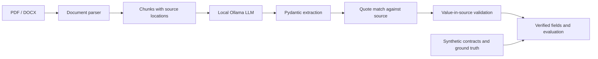

# Contract & Document Verification Agent System

> A research prototype for extracting contract information with source citations and checking those citations with deterministic code.

## English

### Overview

This project explores a safer document-extraction workflow for Vietnamese contracts. A local LLM extracts structured fields and supporting quotations; a Python verifier then checks the quotations against the original document and confirms that each extracted value is supported by the matched source text.

The verifier does **not** use an LLM to judge another LLM. This project is an in-progress academic prototype, not a production-ready contract-processing service.

### What is implemented

- Parse text-based PDF files into page-aware chunks and DOCX files into paragraph chunks.
- Extract seven contract fields as Pydantic-validated `{value, quote}` pairs through an OpenAI-compatible Ollama endpoint.
- Verify that a quote matches the source document, then independently check that the value is present in the matched source text.
- Derive the matching page and chunk in code rather than trusting page numbers returned by the model.
- Generate 12 synthetic PDF/DOCX contracts with ground truth and six scenarios: clean, incorrect tax code, incorrect representative, over-limit value, unknown entity, and missing field.
- Evaluate live extraction and review verifier outcomes against ground truth with `scripts/run_eval.py`.

### Current status

The parser, extraction, citation-verification, synthetic-data, and evaluation components are implemented. LangGraph orchestration, database reconciliation, the HTTP API, and the Streamlit interface are planned work and are **not currently implemented**.

### Architecture



### Tech stack

| Area | Technology |
|---|---|
| Language | Python 3.11+ |
| Document parsing | `pdfplumber`, `python-docx` |
| LLM client | OpenAI-compatible API, Ollama |
| Data validation | Pydantic |
| Fuzzy matching | RapidFuzz |
| Database setup | PostgreSQL 16, SQLAlchemy 2.x, asyncpg |
| Testing | pytest |
| Local services | Docker Compose |

### Quick start

Prerequisites: Python 3.11+, Docker Compose, and Ollama with a compatible model available locally.

1. Create and activate a virtual environment, then install dependencies:

   ```powershell
   python -m venv .venv
   .\.venv\Scripts\Activate.ps1
   python -m pip install -r requirements.txt
   ```

2. Create local configuration:

   ```powershell
   Copy-Item .env.example .env
   ```

   Check `LLM_MODEL` in `.env` against the models installed in Ollama (`ollama list`). The example configuration names `frob/qwen3.5-instruct:4b`; change it if that model is not available in your Ollama setup.

3. Start PostgreSQL and seed the synthetic partner companies:

   ```powershell
   docker compose up -d postgres
   python -m app.db.seed
   ```

4. Generate the sample contracts and ground-truth files:

   ```powershell
   python scripts/generate_dataset.py
   ```

5. Run the tests:

   ```powershell
   pytest -q
   ```

6. Run live extraction and evaluation (requires a reachable Ollama server and an installed model):

   ```powershell
   python scripts/run_eval.py --live
   ```

   Run outputs are written under `data/runs/`, which is excluded from Git.

### Configuration

The project reads local settings from `.env`; `.env` is ignored by Git. See [`.env.example`](.env.example) for the available settings, including the Ollama endpoint/model, database URL, and citation threshold. Keep credentials and machine-specific values out of committed files.

### Limitations

- Only PDF files with a readable text layer and DOCX files are in scope; scanned PDFs/OCR are not supported.
- The sample contracts and company records are synthetic and intended for development and evaluation only.
- Extraction quality and runtime depend on the selected model and the available hardware.
- Fuzzy citation matching is a guardrail, not a guarantee of correctness; thresholds and failure cases should be evaluated on representative data.
- The end-to-end agent, reconciliation workflow, API, and UI remain future work.

### License

No license file is included yet. Add a license before inviting reuse of this repository.

## Tiếng Việt

### Giới thiệu

Đây là prototype nghiên cứu quy trình trích xuất thông tin từ hợp đồng tiếng Việt có kèm trích dẫn nguồn. LLM chạy cục bộ trích xuất dữ liệu có cấu trúc và câu trích dẫn; verifier viết bằng Python kiểm tra trích dẫn trong tài liệu gốc, sau đó xác nhận giá trị có được hỗ trợ bởi đúng đoạn văn bản đã khớp hay không.

Verifier **không dùng LLM để đánh giá một LLM khác**. Dự án đang phát triển trong khuôn khổ niên luận, chưa phải dịch vụ xử lý hợp đồng sẵn sàng cho production.

### Các phần đã triển khai

- Đọc PDF có lớp văn bản thành các chunk kèm số trang; đọc DOCX thành các chunk theo đoạn văn.
- Trích xuất 7 trường hợp đồng thành cặp `{value, quote}`, kiểm tra schema bằng Pydantic và gọi Ollama qua API tương thích OpenAI.
- Kiểm tra quote có khớp với tài liệu gốc, rồi kiểm tra riêng giá trị có xuất hiện trong đoạn nguồn đã khớp hay không.
- Tính trang và chunk bằng code, không tin số trang do model tự trả về.
- Sinh 12 hợp đồng PDF/DOCX giả cùng ground truth, gồm 6 kịch bản: khớp, sai mã số thuế, sai người đại diện, vượt hạn mức, đối tác chưa có trong dữ liệu và thiếu trường.
- Đánh giá extraction thật và đối chiếu kết quả verifier với ground truth bằng `scripts/run_eval.py`.

### Trạng thái hiện tại

Parser, extraction, kiểm chứng trích dẫn, dữ liệu mẫu và script đánh giá đã được triển khai. Phần điều phối LangGraph, đối soát database, HTTP API và giao diện Streamlit là các phần dự kiến làm tiếp, hiện **chưa được triển khai**.

### Kiến trúc

Luồng hiện tại: **PDF/DOCX → parser → các chunk có vị trí nguồn → Ollama LLM → dữ liệu extraction được kiểm tra bằng Pydantic → so khớp quote với tài liệu → xác minh giá trị trong đoạn nguồn → kết quả kiểm chứng và đánh giá**. Bộ hợp đồng giả và ground truth được dùng để chạy đánh giá.

### Công nghệ

| Hạng mục | Công nghệ |
|---|---|
| Ngôn ngữ | Python 3.11+ |
| Đọc tài liệu | `pdfplumber`, `python-docx` |
| Gọi LLM | API tương thích OpenAI, Ollama |
| Kiểm tra dữ liệu | Pydantic |
| So khớp mờ | RapidFuzz |
| Cấu hình database | PostgreSQL 16, SQLAlchemy 2.x, asyncpg |
| Kiểm thử | pytest |
| Dịch vụ cục bộ | Docker Compose |

### Chạy thử nhanh

Cần Python 3.11+, Docker Compose và Ollama có model tương thích đã cài trên máy.

1. Tạo môi trường ảo và cài dependencies:

   ```powershell
   python -m venv .venv
   .\.venv\Scripts\Activate.ps1
   python -m pip install -r requirements.txt
   ```

2. Tạo file cấu hình cục bộ:

   ```powershell
   Copy-Item .env.example .env
   ```

   Kiểm tra `LLM_MODEL` trong `.env` có trong danh sách model Ollama đã cài (`ollama list`). Cấu hình mẫu đang đặt `frob/qwen3.5-instruct:4b`; hãy đổi nếu model đó chưa có trong Ollama của bạn.

3. Khởi động PostgreSQL và nạp dữ liệu đối tác giả:

   ```powershell
   docker compose up -d postgres
   python -m app.db.seed
   ```

4. Sinh hợp đồng mẫu và ground truth:

   ```powershell
   python scripts/generate_dataset.py
   ```

5. Chạy kiểm thử:

   ```powershell
   pytest -q
   ```

6. Chạy extraction và đánh giá với LLM thật (cần Ollama đang hoạt động và model đã được cài):

   ```powershell
   python scripts/run_eval.py --live
   ```

   Kết quả được lưu trong `data/runs/`; thư mục này được loại khỏi Git.

### Cấu hình

Ứng dụng đọc cấu hình cục bộ từ `.env`; file này đã được ignore trong Git. Xem [`.env.example`](.env.example) để biết các thiết lập như endpoint/model Ollama, database URL và ngưỡng kiểm chứng trích dẫn. Không commit thông tin xác thực hoặc cấu hình riêng của máy.

### Giới hạn

- Chỉ hỗ trợ PDF có lớp văn bản đọc được và DOCX; chưa hỗ trợ PDF scan/OCR.
- Hợp đồng và dữ liệu công ty mẫu đều là dữ liệu giả, chỉ dùng cho phát triển và đánh giá.
- Chất lượng trích xuất và thời gian chạy phụ thuộc model và phần cứng.
- So khớp mờ là một lớp guardrail, không đảm bảo tuyệt đối tính đúng; cần đánh giá ngưỡng và ca lỗi trên dữ liệu phù hợp.
- Agent end-to-end, quy trình đối soát, API và UI vẫn là phần việc tiếp theo.

### Giấy phép

Repository hiện chưa có file giấy phép. Hãy bổ sung giấy phép trước khi cho phép người khác tái sử dụng mã nguồn.
