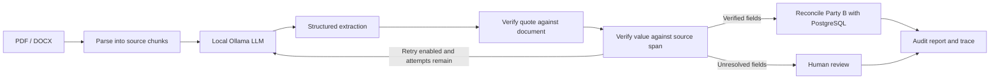
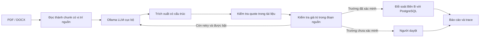

# Contract & Document Verification Agent System

> An AI-assisted system for extracting evidence-backed data from Vietnamese contracts, verifying citations with deterministic code, and flagging discrepancies against a partner registry.

## English

### Project overview

Organizations often need to review contracts and compare partner details against internal records. This project is designed to automate that workflow while keeping extraction evidence visible and preventing an LLM from deciding whether its own answers are correct.

The system uses a local LLM to extract structured fields and verbatim quotations from PDF and DOCX contracts. A deterministic Python verifier checks each quotation against the source document and independently checks that the extracted value is supported by the matched source text. Verified partner data can then be reconciled against PostgreSQL, with discrepancies presented for human review.

This is an academic project and a work in progress. The sections below describe the **complete intended system**; the implementation status table distinguishes available components from planned ones.

### Goals and design principles

- Keep a traceable source quotation for each extracted value.
- Verify quote existence and value-in-quote with code, not with another LLM call.
- Calculate source location from the document text rather than trusting a page number generated by a model.
- Reconcile only **Party B**, the partner being reviewed, against the master entity registry.
- Route uncertain or unsupported information to human review instead of guessing.
- Run the language model locally through Ollama's OpenAI-compatible API.

### End-to-end workflow

1. **Upload and parse a contract.** Accept PDF files with a text layer and DOCX files. Preserve source chunks with their page or paragraph identifiers.
2. **Extract structured fields.** Ask the local LLM to return a Pydantic-compatible JSON object with a value and verbatim quote for each field. Missing information should be `null`.
3. **Verify citations.** Normalize the document and quote, use RapidFuzz to locate the best matching source span, and apply the configured citation threshold. Then check the extracted value against the original text at that span using field-specific normalizers.
4. **Retry recoverable extraction errors.** When enabled, request only fields whose quote or value failed verification. Limit retries; unresolved fields are sent for human review.
5. **Reconcile verified partner data.** Compare verified Party B information with PostgreSQL master entities. Use tax code as the primary key, with fuzzy name matching to detect identity mismatches. Check contract value against the partner's configured limit.
6. **Report results.** Return verified fields, source locations, audit warnings, processing status, and a trace of workflow decisions.



### Extracted fields

Each field is represented as `{ "value": "...", "quote": "..." }`. Both may be `null` when the information is not present.

| Field | Purpose |
|---|---|
| `party_a_name` | Contracting company on Party A's side |
| `party_b_name` | Partner company being reviewed |
| `party_b_tax_code` | Partner's tax identification number |
| `party_b_legal_representative` | Partner's legal representative |
| `contract_value` | Contract amount |
| `effective_date` | Contract effective date |
| `payment_terms` | Payment terms |

Core fields for reconciliation are Party B's name, tax code, and contract value. Other extracted fields provide additional context or checks.

### Citation verification and guardrails

The verifier has two independent checks:

1. **Quote-to-document:** normalize Unicode and whitespace, then locate the quote in the normalized source with `rapidfuzz.fuzz.partial_ratio_alignment`. The default `CITATION_THRESHOLD` is `85`; it is configurable and should be evaluated on representative data.
2. **Value-in-source:** check the value against the original document span identified by the match, not against text supplied by the LLM alone. Apply type-aware normalization for money, Vietnamese dates, tax codes, company/person names, and payment terms.

Possible field statuses:

- `VERIFIED`: the quote and extracted value are supported by the source.
- `QUOTE_NOT_FOUND`: no quote was supplied or the quote did not meet the matching threshold.
- `VALUE_NOT_IN_QUOTE`: the quote matched, but the extracted value was not supported by the original matched text.
- `NOT_PRESENT`: the value is `null` because the field is absent.

For unresolved citation errors, the workflow may request a bounded retry. Once retries are disabled or exhausted, the field requires human review and is excluded from automatic reconciliation.

### Partner reconciliation

The reconciliation engine is designed to use only verified fields and never call the LLM:

- Match a verified tax code exactly against `master_entities.vat_code`.
- Compare the partner name with the registry using normalized text and RapidFuzz token similarity.
- Check the verified legal representative when available.
- Compare the contract amount with the partner's maximum contract value.
- If a tax-code match is unavailable, use name matching to distinguish a likely identity mismatch from an unknown entity. Missing or unverified required data should be escalated for review.

Audit outcomes include `ENTITY_NOT_FOUND`, `IDENTITY_MISMATCH`, `VALUE_OVER_LIMIT`, and `NEEDS_HUMAN_REVIEW`. Overall results are `CLEAN`, `NEEDS_REVIEW`, or `DISCREPANCY_FOUND`.

### Planned API and user interface

The target API is versioned under `/api/v1`:

| Method | Endpoint | Purpose |
|---|---|---|
| `POST` | `/contracts/upload` | Validate and store a PDF/DOCX contract |
| `POST` | `/audit/process/{contract_id}` | Start background contract processing |
| `GET` | `/audit/result/{contract_id}` | Retrieve status, verified fields, warnings, and optionally the trace |
| `GET` | `/healthz` | Health check |

A minimal Streamlit interface is planned for uploading a contract and reviewing its extracted fields, citations, and audit results. These API and UI workflows are part of the target design; they are not yet implemented.

### Evaluation and sample data

The dataset generator creates **12 synthetic contracts** in PDF and DOCX formats and corresponding ground-truth JSON files. The scenarios cover clean records, incorrect tax codes, incorrect representatives, over-limit amounts, unknown entities, and missing fields. Synthetic companies and people are used; sample records are shared between the database seed and contract generator.

The evaluation script can:

- Run live extraction against the sample contracts and compare normalized field values with ground truth.
- Save per-run raw model responses and field-level results under `data/runs/`.
- Run the citation verifier on saved extraction output and report verifier statuses, false positives/negatives against ground truth, and score distributions.

The longer-term evaluation plan is to expand the dataset, measure extraction and reconciliation quality, test intentionally corrupted citations, and compare verifier/retry configurations. No accuracy target is claimed without measured results.

### Technology stack

| Area | Technology |
|---|---|
| Language | Python 3.11+ |
| LLM | Qwen model served locally by Ollama |
| LLM integration | OpenAI-compatible Python client |
| Extraction schema | Pydantic |
| PDF/DOCX parsing | `pdfplumber`, `python-docx` |
| Citation matching | RapidFuzz |
| Workflow orchestration (planned) | LangGraph |
| Database (planned workflow) | PostgreSQL 16, SQLAlchemy 2.x, asyncpg |
| API (planned) | FastAPI |
| UI (planned) | Streamlit |
| Tests | pytest |
| Local database service | Docker Compose |

### Repository layout

```text
app/
  core/           Configuration
  db/             Database models, connection, and seed data
  extraction/     Pydantic schema and LLM extraction
  guardrails/     Text normalizers and citation verifier
  llm/            Ollama client and extraction prompts
  parsing/        PDF and DOCX parsing
  agent/          Planned workflow orchestration
  api/            Planned HTTP API
  reconciliation/ Planned partner reconciliation
scripts/
  generate_dataset.py
  run_eval.py
  check_llm_speed.py
tests/
data/
  contracts/      Generated sample contracts
  ground_truth/   Expected normalized values and audit outcomes
  runs/           Local evaluation output (not committed)
ui/               Planned Streamlit interface
```

### Getting started

Prerequisites: Python 3.11+, Docker Compose, and Ollama with a compatible model installed and running locally.

1. Create a virtual environment and install dependencies:

   ```powershell
   python -m venv .venv
   .\.venv\Scripts\Activate.ps1
   python -m pip install -r requirements.txt
   ```

2. Create local configuration:

   ```powershell
   Copy-Item .env.example .env
   ```

   Check `LLM_MODEL` in `.env` against `ollama list`. The example uses `frob/qwen3.5-instruct:4b`; set it to a model available in your Ollama environment if necessary. Keep `.env` local and never commit secrets.

3. Start PostgreSQL and seed the synthetic partner registry:

   ```powershell
   docker compose up -d postgres
   python -m app.db.seed
   ```

4. Generate the sample contracts and ground truth:

   ```powershell
   python scripts/generate_dataset.py
   ```

5. Run the tests:

   ```powershell
   pytest -q
   ```

6. Run live extraction and evaluation (requires a reachable Ollama server and installed model):

   ```powershell
   python scripts/run_eval.py --live
   ```

Generated evaluation results are written under `data/runs/` and are excluded from Git.

### Configuration

Copy [`.env.example`](.env.example) to `.env` and configure the database URL, Ollama endpoint and model, citation/name thresholds, retry limit, and feature flags. The example database service runs in Docker Compose; Ollama is expected to run on the host machine.

### Scope and limitations

- Supports text-based PDF and DOCX only. Scanned PDFs/OCR are out of scope.
- The sample dataset is synthetic and is not representative of all real-world contract layouts.
- Fuzzy matching is a heuristic guardrail, not a proof of semantic correctness.
- Model output and runtime depend on the selected model, prompt, and available hardware.
- The API, Streamlit UI, full LangGraph workflow, automatic reconciliation flow, and expanded benchmark remain planned work.
- This repository does not yet include a license. Add one before granting permission for reuse.

### Project status

| Component | Status |
|---|---|
| PDF/DOCX parser | Implemented |
| Pydantic extraction schema and Ollama extraction | Implemented |
| Citation verifier and field normalizers | Implemented |
| Synthetic dataset and ground truth | Implemented |
| Baseline and verifier evaluation scripts | Implemented |
| PostgreSQL models, connection, and seed | Implemented |
| LangGraph retries and end-to-end agent | Planned |
| Automatic reconciliation workflow | Planned |
| FastAPI endpoints and Streamlit UI | Planned |
| Expanded evaluation and ablation study | Planned |

## Tiếng Việt

### Giới thiệu dự án

Doanh nghiệp thường cần đọc hợp đồng và đối chiếu thông tin đối tác với dữ liệu nội bộ. Dự án hướng đến tự động hóa quy trình đó nhưng vẫn giữ được bằng chứng nguồn cho từng giá trị, đồng thời không để LLM tự quyết định câu trả lời của chính nó có đúng hay không.

LLM chạy cục bộ dùng để trích xuất các trường dữ liệu và câu trích dẫn nguyên văn từ hợp đồng PDF/DOCX. Verifier Python kiểm tra quote trong tài liệu gốc và kiểm tra riêng giá trị có được đoạn nguồn đã khớp hỗ trợ hay không. Thông tin đã xác minh của Bên B sau đó được thiết kế để đối soát với PostgreSQL và phát hiện sai lệch cần con người xem xét.

Đây là đề tài niên luận đang phát triển. Các mục dưới đây mô tả **thiết kế đầy đủ của hệ thống hướng tới**; bảng trạng thái ở cuối README cho biết rõ phần nào đã có và phần nào còn trong kế hoạch.

### Mục tiêu và nguyên tắc thiết kế

- Mỗi giá trị trích xuất có quote để truy vết về tài liệu gốc.
- Kiểm tra quote và giá trị bằng code thuần, không dùng một LLM khác để xác minh.
- Vị trí nguồn do code tính, không tin số trang do model tự khai.
- Chỉ đối soát **Bên B** — đối tác cần thẩm định — với dữ liệu doanh nghiệp chuẩn.
- Thông tin không đủ tin cậy được chuyển cho người duyệt, không suy đoán.
- Model chạy cục bộ qua API tương thích OpenAI của Ollama.

### Luồng xử lý đầy đủ

1. **Nhận và đọc hợp đồng:** hỗ trợ PDF có lớp văn bản và DOCX; giữ chunk nguồn cùng số trang hoặc chỉ số đoạn.
2. **Trích xuất dữ liệu:** yêu cầu LLM trả JSON theo schema Pydantic, mỗi trường gồm giá trị và quote nguyên văn; thông tin không có thì trả `null`.
3. **Kiểm chứng trích dẫn:** chuẩn hóa tài liệu và quote, dùng RapidFuzz tìm đoạn nguồn phù hợp nhất rồi so với ngưỡng cấu hình. Tiếp theo, kiểm tra giá trị dựa trên văn bản gốc tại đoạn khớp bằng normalizer theo loại trường.
4. **Thử lại khi lỗi có thể khắc phục:** nếu được bật, chỉ yêu cầu trích xuất lại các trường có quote hoặc giá trị không hợp lệ. Giới hạn số lần retry; lỗi chưa khắc phục được chuyển cho người duyệt.
5. **Đối soát đối tác đã xác minh:** so dữ liệu Bên B với `master_entities` trong PostgreSQL. MST là khóa chính; so tên mờ để phát hiện sai lệch danh tính. Giá trị hợp đồng được so với hạn mức của đối tác.
6. **Xuất kết quả:** trả trạng thái, trường đã xác minh, vị trí nguồn, cảnh báo và trace các quyết định trong quy trình.



### Các trường trích xuất

Mỗi trường có dạng `{ "value": "...", "quote": "..." }`. Cả hai có thể là `null` nếu tài liệu không có thông tin.

| Trường | Ý nghĩa |
|---|---|
| `party_a_name` | Tên công ty Bên A |
| `party_b_name` | Tên công ty đối tác cần thẩm định |
| `party_b_tax_code` | Mã số thuế của đối tác |
| `party_b_legal_representative` | Người đại diện pháp luật của đối tác |
| `contract_value` | Giá trị hợp đồng |
| `effective_date` | Ngày có hiệu lực |
| `payment_terms` | Điều khoản thanh toán |

Các trường cốt lõi cho đối soát là tên, MST và giá trị hợp đồng của Bên B. Các trường còn lại bổ sung ngữ cảnh hoặc phép kiểm tra.

### Citation verifier và guardrail

Verifier có hai lớp độc lập:

1. **Quote với tài liệu:** chuẩn hóa Unicode và khoảng trắng, sau đó dùng `rapidfuzz.fuzz.partial_ratio_alignment` tìm quote trong văn bản đã chuẩn hóa. Ngưỡng mặc định `CITATION_THRESHOLD` là `85`, có thể cấu hình và cần được đánh giá trên dữ liệu phù hợp.
2. **Giá trị với nguồn:** kiểm tra giá trị trên đoạn tài liệu gốc được xác định từ vị trí khớp, không chỉ dựa vào quote do LLM gửi. Chuẩn hóa theo kiểu dữ liệu như tiền, ngày Việt Nam, MST, tên công ty/người và điều khoản thanh toán.

Trạng thái của field:

- `VERIFIED`: quote và giá trị được tài liệu hỗ trợ.
- `QUOTE_NOT_FOUND`: thiếu quote hoặc quote không đạt ngưỡng tương đồng.
- `VALUE_NOT_IN_QUOTE`: quote khớp nhưng giá trị không được văn bản gốc tại đoạn đó hỗ trợ.
- `NOT_PRESENT`: giá trị là `null` vì tài liệu không có trường đó.

Lỗi citation có thể được yêu cầu trích xuất lại trong giới hạn cấu hình. Nếu retry bị tắt hoặc hết lượt, field cần người duyệt và không được đưa vào đối soát tự động.

### Đối soát đối tác

Reconciliation engine được thiết kế chỉ dùng các trường đã xác minh và không gọi LLM:

- Tìm chính xác MST đã xác minh trong `master_entities.vat_code`.
- Chuẩn hóa tên đối tác và dùng độ tương đồng token của RapidFuzz để so với registry.
- Kiểm tra người đại diện đã xác minh nếu tài liệu có thông tin.
- So giá trị hợp đồng với hạn mức tối đa của đối tác.
- Nếu không khớp MST, dùng so khớp tên để phân biệt trường hợp sai định danh với công ty chưa có trong hệ thống. Thiếu dữ liệu bắt buộc hoặc chưa xác minh thì chuyển sang người duyệt.

Các loại audit gồm `ENTITY_NOT_FOUND`, `IDENTITY_MISMATCH`, `VALUE_OVER_LIMIT` và `NEEDS_HUMAN_REVIEW`. Kết quả tổng thể gồm `CLEAN`, `NEEDS_REVIEW` và `DISCREPANCY_FOUND`.

### API và giao diện dự kiến

API mục tiêu được version hóa dưới `/api/v1`:

| Method | Endpoint | Mục đích |
|---|---|---|
| `POST` | `/contracts/upload` | Kiểm tra và lưu file PDF/DOCX |
| `POST` | `/audit/process/{contract_id}` | Bắt đầu xử lý hợp đồng nền |
| `GET` | `/audit/result/{contract_id}` | Lấy trạng thái, field đã xác minh, cảnh báo và trace nếu yêu cầu |
| `GET` | `/healthz` | Health check |

Giao diện Streamlit tối thiểu được dự kiến để tải hợp đồng và xem field trích xuất, citation cùng kết quả audit. API và UI này thuộc thiết kế mục tiêu, hiện chưa được triển khai.

### Đánh giá và dữ liệu mẫu

Script sinh dữ liệu tạo **12 hợp đồng giả** ở định dạng PDF/DOCX cùng các file ground truth JSON. Sáu kịch bản gồm: hồ sơ khớp, sai MST, sai người đại diện, vượt hạn mức, đối tác chưa có trong registry và thiếu trường. Công ty, cá nhân đều là dữ liệu giả; dữ liệu mẫu dùng chung giữa seed database và bộ sinh hợp đồng.

Script đánh giá có thể:

- Chạy extraction với LLM thật trên các hợp đồng mẫu và so sánh giá trị đã chuẩn hóa với ground truth.
- Lưu phản hồi thô của model và kết quả từng field vào `data/runs/`.
- Chạy verifier trên kết quả đã lưu, thống kê trạng thái, trường hợp bắt oan/lọt lưới theo ground truth và phân bố điểm.

Kế hoạch đánh giá tiếp theo là mở rộng bộ dữ liệu, đo chất lượng extraction/đối soát, thử quote bị cố ý làm sai và so sánh cấu hình verifier/retry. Không đưa ra chỉ tiêu độ chính xác nếu chưa có số đo thực tế.

### Công nghệ

| Hạng mục | Công nghệ |
|---|---|
| Ngôn ngữ | Python 3.11+ |
| LLM | Model Qwen chạy cục bộ qua Ollama |
| Kết nối LLM | Python client tương thích OpenAI |
| Schema extraction | Pydantic |
| Đọc PDF/DOCX | `pdfplumber`, `python-docx` |
| So khớp citation | RapidFuzz |
| Điều phối workflow (dự kiến) | LangGraph |
| Database (workflow dự kiến) | PostgreSQL 16, SQLAlchemy 2.x, asyncpg |
| API (dự kiến) | FastAPI |
| Giao diện (dự kiến) | Streamlit |
| Kiểm thử | pytest |
| Database cục bộ | Docker Compose |

### Cấu trúc repository

```text
app/
  core/           Cấu hình
  db/             Model, kết nối và dữ liệu seed
  extraction/     Schema Pydantic và extraction bằng LLM
  guardrails/     Normalizer và citation verifier
  llm/            Ollama client và prompt
  parsing/        Đọc PDF và DOCX
  agent/          Điều phối workflow (dự kiến)
  api/            HTTP API (dự kiến)
  reconciliation/ Đối soát đối tác (dự kiến)
scripts/
  generate_dataset.py
  run_eval.py
  check_llm_speed.py
tests/
data/
  contracts/      Hợp đồng mẫu được sinh
  ground_truth/   Giá trị chuẩn hóa và kết quả audit mong đợi
  runs/           Kết quả đánh giá cục bộ (không commit)
ui/               Giao diện Streamlit (dự kiến)
```

### Cài đặt và chạy

Cần Python 3.11+, Docker Compose và Ollama có model tương thích đã được cài và đang chạy cục bộ.

1. Tạo môi trường ảo và cài dependencies:

   ```powershell
   python -m venv .venv
   .\.venv\Scripts\Activate.ps1
   python -m pip install -r requirements.txt
   ```

2. Tạo cấu hình cục bộ:

   ```powershell
   Copy-Item .env.example .env
   ```

   Kiểm tra `LLM_MODEL` trong `.env` với `ollama list`. Cấu hình ví dụ dùng `frob/qwen3.5-instruct:4b`; nếu Ollama chưa có model này, hãy đổi sang model đã cài. Giữ `.env` ở máy cục bộ, không commit secret.

3. Khởi động PostgreSQL và nạp registry đối tác giả:

   ```powershell
   docker compose up -d postgres
   python -m app.db.seed
   ```

4. Sinh hợp đồng và ground truth:

   ```powershell
   python scripts/generate_dataset.py
   ```

5. Chạy test:

   ```powershell
   pytest -q
   ```

6. Chạy extraction và đánh giá với LLM thật (cần Ollama hoạt động và model đã cài):

   ```powershell
   python scripts/run_eval.py --live
   ```

Kết quả chạy được lưu trong `data/runs/`, thư mục này được loại khỏi Git.

### Cấu hình

Sao chép [`.env.example`](.env.example) thành `.env` và cấu hình database URL, Ollama endpoint/model, ngưỡng citation/tên, số lượt retry và các cờ tính năng. Database mẫu chạy qua Docker Compose; Ollama dự kiến chạy trực tiếp trên máy chính.

### Phạm vi và giới hạn

- Chỉ hỗ trợ PDF có lớp văn bản và DOCX; chưa hỗ trợ PDF scan/OCR.
- Bộ dữ liệu mẫu là dữ liệu giả, chưa đại diện cho mọi bố cục hợp đồng thực tế.
- So khớp mờ là heuristic guardrail, không chứng minh được ngữ nghĩa đúng tuyệt đối.
- Chất lượng và thời gian phụ thuộc model, prompt và phần cứng.
- API, UI Streamlit, workflow LangGraph đầy đủ, luồng đối soát tự động và benchmark mở rộng vẫn là phần dự kiến.
- Repository chưa có license. Cần bổ sung license trước khi cho phép tái sử dụng mã nguồn.

### Trạng thái dự án

| Thành phần | Trạng thái |
|---|---|
| Parser PDF/DOCX | Đã triển khai |
| Schema Pydantic và extraction qua Ollama | Đã triển khai |
| Citation verifier và normalizer | Đã triển khai |
| Bộ dữ liệu giả và ground truth | Đã triển khai |
| Script đánh giá baseline và verifier | Đã triển khai |
| PostgreSQL models, kết nối và seed | Đã triển khai |
| LangGraph retry và agent end-to-end | Dự kiến |
| Luồng đối soát tự động | Dự kiến |
| FastAPI endpoints và giao diện Streamlit | Dự kiến |
| Đánh giá mở rộng và ablation | Dự kiến |
