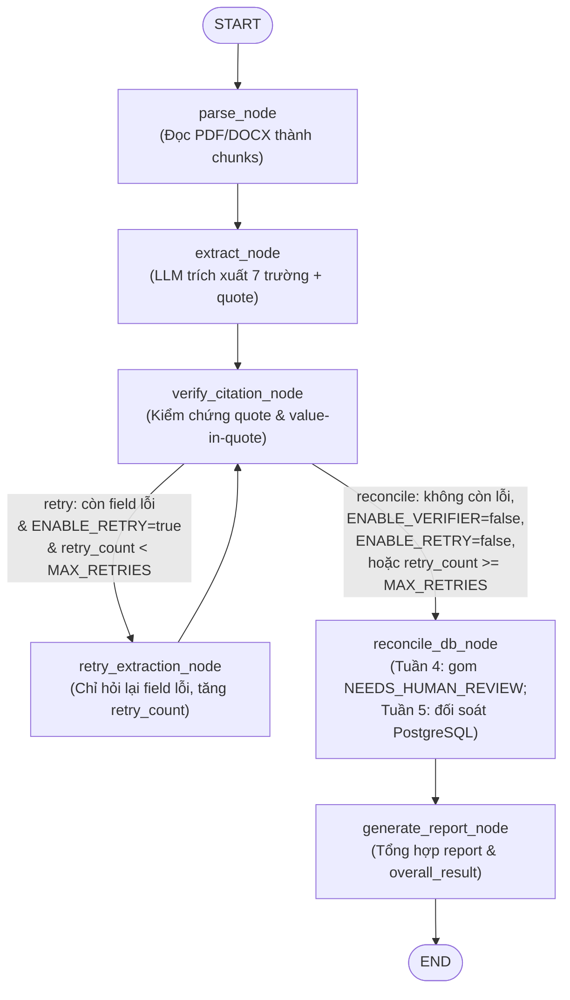

# Sơ đồ StateGraph — Contract & Document Verification Agent

Sơ đồ dưới đây phản ánh đúng cấu trúc `StateGraph` đã biên dịch trong [`app/agent/graph.py`](../app/agent/graph.py) (LangGraph `1.2.20`).

## Ghi chú cho Báo cáo Chương 3

- **State dùng chung (`ContractAuditState`):** lưu `chunks`, `raw_extraction`, `verified_fields`, `retry_count`, `audit_items`, `overall_result`, `report` và `trace_log` (dùng reducer `operator.add` để nối dồn lịch sử từng bước qua các vòng lặp retry).
- **Chặn lặp vô hạn:** hàm định tuyến `route_after_verify` chỉ quay lại `retry_extraction_node` khi đồng thời thỏa mãn 3 điều kiện: `ENABLE_VERIFIER=true`, `ENABLE_RETRY=true`, `retry_count < MAX_RETRIES` và vẫn còn trường mang trạng thái `QUOTE_NOT_FOUND` hoặc `VALUE_NOT_IN_QUOTE`.
- **Bảo toàn dữ liệu đã xác thực:** `retry_extraction_node` chỉ gửi lại danh sách trường lỗi cho LLM và chỉ cập nhật đúng các trường đó vào `raw_extraction`, không cho phép ghi đè các trường đã đạt `VERIFIED`.
- **Xử lý khi tắt verifier (`ENABLE_VERIFIER=false`):** phục vụ thí nghiệm ablation ở Tuần 7 — `verify_citation_node` bỏ qua `CitationVerifier`, chuyển mọi trường có giá trị thành `VERIFIED` (với `match_score=None, page=None, chunk_id=None`) để đi thẳng vào đối soát, còn trường bắt buộc bị `None` vẫn giữ `NOT_PRESENT` và sinh `NEEDS_HUMAN_REVIEW`.
